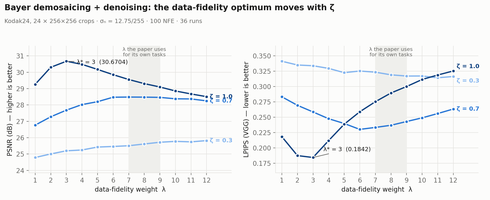
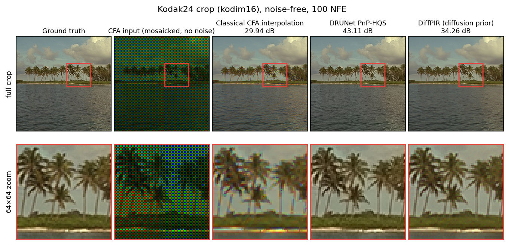
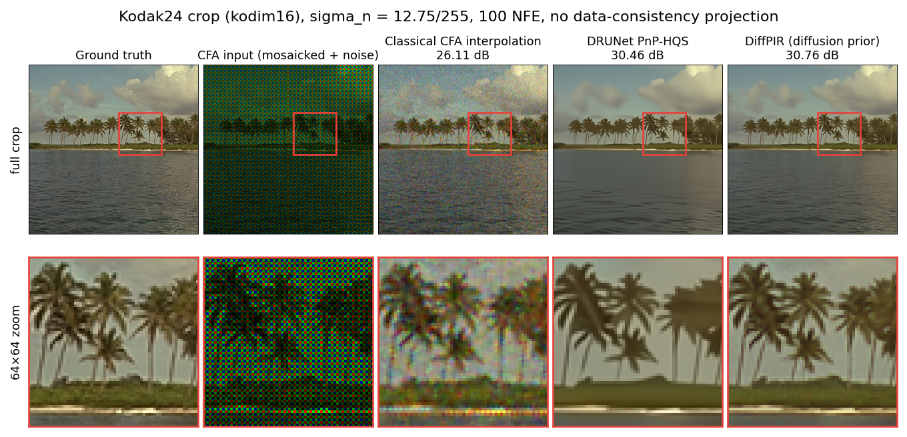
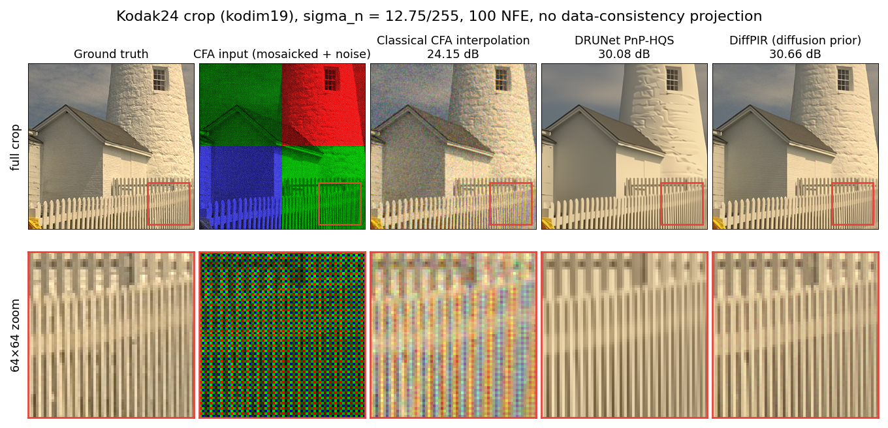

# Diffusion Priors for Plug-and-Play Image Restoration — Reproduction + a Bayer Demosaicing Extension

A reproduction of **DiffPIR** (Zhu et al., *Denoising Diffusion Models for Plug-and-Play Image Restoration*, CVPR Workshops / NTIRE 2023) on super-resolution, Gaussian deblurring and inpainting, plus one task the paper does not cover: **Bayer CFA demosaicing under additive noise**, formulated as channel-wise masked restoration, with its data-fidelity weight swept and its optimum explained.

The extension is compared against two baselines run through the identical degradation, solver and metric path: classical CFA interpolation, and a **DPIR-style PnP-HQS solver with a DRUNet denoiser** — the same closed-form data step with the prior as the only variable. Without noise the CNN prior wins by 3–6.5 dB; with noise the ordering appears to reverse, and §3.4 shows the reversal is a data-consistency projection rather than the prior.

This is a **reproduction and extension, not a new method.** No claim of state of the art. The diffusion priors are pretrained and used at inference time only; nothing here is trained from scratch.

**Why this project:** my PhD work is plug-and-play restoration — a denoiser used as an implicit prior inside an iterative solver (CVPR 2021, EUSIPCO 2025). DiffPIR keeps that skeleton and swaps the discriminative prior for a generative one, so it is the shortest honest path from what I already do to diffusion-based restoration.

---

## 1. What is in here

| | |
|---|---|
| **Step 1 — reproduction** | DiffPIR on SR ×4, Gaussian deblurring, random inpainting; paper's 100-image FFHQ validation split; PSNR / LPIPS vs published values → [§2](#2-step-1--reproduction-results) |
| **Step 2 — extension** | Bayer CFA demosaicing + denoising via a channel-wise mask in the same closed-form data step; λ / ζ swept (36 runs), optimum explained, quality-vs-NFE curve → [§3](#3-step-2--bayer-demosaicing-extension) |
| **Diffusion prior vs CNN prior** | the same solver with DRUNet in place of the diffusion model: **+6.54 / +3.12 dB for the CNN prior without noise**; with noise the ordering reverses by 2.3–2.5 dB, and that reversal turns out to be one data-consistency projection, not the prior → [§3.4](#34-baseline-drunet-pnp-hqs--the-comparison-that-isolates-the-prior) |
| **Reproduction notes** | One implementation/paper discrepancy worth 2.7 dB, and two configuration traps → [§2.3](#23-one-discrepancy-between-the-released-code-and-the-paper), [§2.4](#24-two-configuration-traps) |
| **How to run** | Environment, checkpoints, commands, data preparation → [§4](#4-how-to-run) |

**This repository is a patch set, not a fork.** It carries only what is new or modified; clone [upstream DiffPIR](https://github.com/yuanzhi-zhu/DiffPIR) and drop these in.

| Path | |
|---|---|
| `main_ddpir_demosaic.py` | the demosaicing entry point — a copy of `main_ddpir_inpainting.py` differing in its mask and import |
| `main_ddpir_demosaic_drunet.py` | the PnP-CNN baseline (§3.4): same mask, same data step, DRUNet prior on DPIR's HQS schedule. Needs three files from [DPIR](https://github.com/cszn/DPIR), see §4.2 |
| `utils_inpaint.py` | → `utils/utils_inpaint.py`, adds `bayer_mask()` |
| `make_crops.py` | builds the 256×256 even-origin crops for Kodak24 / McMaster |
| `data/*/crops.csv` | the exact crop manifests (source file + box) for all 42 crops |
| `scripts/` | the SLURM/cluster scripts every run here was produced with, plus `README-cluster.md` |
| `scripts/61-make-sidebyside.py` | assembles the side-by-side visual comparison from the saved per-image outputs (numpy / matplotlib / Pillow only) |
| `scripts/62-error-budget.py` | splits a run's squared error by the Bayer mask — the §3.4.4 table |

---

## 2. Step 1 — reproduction results

### 2.1 Headline numbers

Evaluated on **`ffhq_val_100`** — the 100-image 256×256 FFHQ hold-out split used in the paper — with the paper's own Table 3 hyperparameters (λ, ζ). Prior: `diffusion_ffhq_10m`. Metrics: PSNR (dB, RGB) and LPIPS (VGG backbone, as in the released code).

| Task | NFE | σ<sub>n</sub> | λ / ζ | **Mine** PSNR / LPIPS | **Paper** PSNR / LPIPS | ΔPSNR | ΔLPIPS |
|---|---|---|---|---|---|---|---|
| Deblur (Gaussian, 61×61, std 3.0) | 100 | 0.05 | 7.0 / 0.3 | **27.26** / **0.2242** | 27.36 / 0.236 | **−0.10** | −0.012 |
| SR ×4 (bicubic) † | 100 | 0.05 | 8.0 / 0.2 | **26.24** / **0.2552** | 26.64 / 0.260 | **−0.40** | −0.005 |
| Inpaint (random mask) | 20 | 0.0 | 7.0 / 1.0 | **34.06** / **0.1118** | 34.03 / 0.116 | **+0.03** | −0.004 |

**PSNR is within 0.4 dB of the published value on all three tasks; LPIPS is at or below the published value on all three.**

Paper references: Table 1 (σ<sub>n</sub> = 0.05, 100 NFE) for deblurring and SR, Table 2 (σ<sub>n</sub> = 0) for inpainting, Table 3 for λ / ζ.

> † The SR row is a run at exactly the paper's ζ = 0.2 (26.2397 / 0.2552), confirmed against the full-reproduction log. On the 5-image subset ζ turned out to be insensitive for this task (ζ = 0.25 → 25.24 / 0.2645 vs ζ = 0.2 → 25.11 / 0.2653), which is why the sweep logs and the final run agree.

Approximate single-image cost on one GH200 (100 NFE, 256×256): ~5 s deblur, ~4 s SR, ~1.4 s inpaint at 20 NFE.

### 2.2 How the remaining gap was accounted for

The interesting part of this reproduction was not the final table, it was ruling out the alternative explanations for an earlier mismatch.

An intermediate stage evaluated on the 5 images shipped in the repo's `demo_test/`:

| Task | Mine (5 images) | Paper (100 images) | ΔPSNR |
|---|---|---|---|
| Deblur (Gaussian) | 25.91 / 0.2444 | 27.36 / 0.236 | −1.45 |
| SR ×4 | 25.11 / 0.2653 | 26.64 / 0.260 | −1.53 |
| Inpaint (random) | 32.70 / 0.1212 | 34.03 / 0.116 | −1.33 |

ΔPSNR spans only **0.2 dB across the three tasks**, even though their degradation operators and closed-form data sub-problems share nothing (Gaussian convolution / bicubic downsampling / binary mask). An implementation error would not be that uniform. A **uniform offset points at the evaluation set**, not at the code — so the hypothesis was: the gap is `demo_test`'s 5 images vs the paper's 100-image hold-out split.

Switching to `ffhq_val_100` removed the offset entirely (table in §2.1). Hypothesis → designed control → competing explanations excluded.

Residuals (LPIPS consistently ~0.005 lower, SR 0.4 dB lower) are attributed to operator-level numerical differences between torch 2.13 and the paper's 1.13, and to random seeding. Not pursued further.

### 2.3 One discrepancy between the released code and the paper

`main_ddpir.py:61` in the released implementation:

```python
kernel_std_i = self.config.kernel_std * np.abs(np.random.rand() * 2 + 1)
```

The base `kernel_std = 3.0` matches the paper, but it is multiplied by a random factor in [1, 3) — so the effective Gaussian blur std is drawn per image from [3.0, 9.0), mean 6.0, i.e. **twice the paper's fixed value**. Section 4.1 of the paper specifies *"a blur kernel of size 61×61 and a standard deviation of 3.0"*.

Fix — drop the random factor:

```python
kernel_std_i = self.config.kernel_std
```

Effect on Gaussian deblurring: PSNR **23.22 → 25.91** (+2.69 dB) on `demo_test`, LPIPS 0.3015 → 0.2444; and 27.26 on the full 100-image split. Without this fix, running the full split still lands around 23 dB with no obvious place to look.

This is a common situation in reproduction work and not a criticism of the authors — released research code drifts from the manuscript. Recording it because locating it is the part that took the work.

### 2.4 Two configuration traps

1. **`lambda_` in `configs/sisr.yaml` is a multiplier, not λ.** The script sweeps `lambda_ × [2, 3, …, 12]`. So `lambda_: 1.0` sweeps λ = 2…12 (which *includes* the paper's 8), while `lambda_: 8.0` sweeps λ = 16…96 — all past the paper's value, and the results get worse (λ = 16 gives 24.57 / 0.2743). To reproduce λ = 8, keep `lambda_: 1.0` and read the `lambda:8.0` group out of the log.
2. **The last line of the SR log is not the result.** `Average PSNR 25.2017 / LPIPS 0.2772` at the end of a sweep is the mean over all 11 λ groups. Take the λ = 8 group.

### 2.5 Two experiment settings to check first when numbers do not match

- The paper evaluates **100 hold-out validation images** per dataset, not the 5 in `demo_test`. A single image deviating several dB from the mean is normal.
- The Gaussian kernel is **61×61, std 3.0**; the motion kernel is 61×61, intensity 0.5, and all compared methods share the same kernel instance.

---

## 3. Step 2 — Bayer demosaicing extension

> **Scope.** Everything below is this project's own result: the paper does not cover demosaicing, so there is no published λ / ζ to copy and no published number to match. Two baselines are run on the same 42 crops through the same code: classical CFA interpolation (§3.3) and a DRUNet PnP-HQS solver (§3.4), the latter being the one that isolates the prior.

### 3.1 Formulation

Bayer CFA demosaicing is masked restoration with a **channel-wise** mask: each pixel retains exactly one of its three colour channels. That makes the measurement operator a binary diagonal, so DiffPIR's inpainting data sub-problem — which already has a closed-form solution for a diagonal operator (`sub_1_analytic: true`) — applies unchanged. The extension is a mask, not a new solver.

`bayer_mask()` produces an RGGB pattern: sampling rates R/G/B = 0.25 / 0.5 / 0.25, exactly one channel active per pixel, top-left 2×2 = `[[R, G], [G, B]]` (verified numerically).

### 3.2 Results

Prior: `256x256_diffusion_uncond` (the general-image model, not the FFHQ one). Degradation: RGGB mosaic plus AWGN at σ<sub>n</sub> = 12.75/255 ≈ 0.05, added in the [-1, 1] domain and then re-masked, i.e. noise only on sampled pixels. Data: 256×256 centre crops with even-numbered origins (§4.3). Metrics: PSNR (RGB) and LPIPS (VGG); **SSIM is not reported — it was not computed in these runs.**

⚠️ **These numbers are on 256×256 centre crops and are not comparable to full-resolution Kodak / McMaster figures in the demosaicing literature.** The crops deliberately take the most detailed part of each image, so any method scores lower on them than on the full frames. Comparisons are only meaningful against methods run on these same 42 crops — which is why `data/*/crops.csv` is in this repository.

**Operating point: λ = 3, ζ = 1.0, 100 NFE.**

| Dataset | Images | PSNR | LPIPS |
|---|---|---|---|
| Kodak24 (crops) | 24 | **30.6704** | **0.1842** |
| McMaster (crops) | 18 | **31.2000** | **0.1743** |

The operating point was tuned on Kodak24 only and transferred to McMaster unchanged, where both metrics improve — so λ\* = 3 is not a Kodak-specific fit. (The absolute gap between the two sets reflects their content: these McMaster crops carry less high-frequency colour structure.)

#### 3.2.1 Where the optimum sits, and why it is not the paper's

Sweeping the data-fidelity weight λ at ζ = 1.0 gives a single-peaked curve with **λ\* = 3**, where PSNR and LPIPS are optimal simultaneously:

| λ | 1 | 2 | **3** | 4 | 5 | 6 | 7 | 8 | 9 | 10 | 11 | 12 |
|---|---|---|---|---|---|---|---|---|---|---|---|---|
| PSNR | 29.2581 | 30.3022 | **30.6704** | 30.4815 | 30.1720 | 29.8508 | 29.5552 | 29.3040 | 29.0977 | 28.8538 | 28.6718 | 28.5057 |
| LPIPS | 0.2181 | 0.1873 | **0.1842** | 0.2117 | 0.2384 | 0.2587 | 0.2751 | 0.2893 | 0.2998 | 0.3113 | 0.3186 | 0.3252 |



The paper's own σ<sub>n</sub> = 0.05 tasks use λ in **7–9** (deblurring 7–8, SR 8–9). Demosaicing lands much lower, and the mechanism is in the data step itself: with ρ = λσ²/σ<sub>k</sub>² and the closed form `(mask·y + ρ·x₀)/(mask + ρ)`, a larger λ trusts the prior over the measurement. The CFA operator is **pointwise** — every retained pixel carries its own independent noise, with no neighbourhood averaging. Deblurring and super-resolution operators average, so their effective measurement noise is lower and they can afford to lean on the prior harder. A mask gives no such cushion, so λ must be smaller.

#### 3.2.2 ζ: the boundary value is the right one

ζ ∈ {0.3, 0.7, 1.0} × λ ∈ {1…12}, 36 runs, three complete curves:

| ζ | λ\* | best PSNR | best LPIPS |
|---|---|---|---|
| **1.0** | **3** | **30.6704** | **0.1842** |
| 0.7 | ≈6–7 | 28.4813 | 0.2300 |
| 0.3 | > 12 (no peak in range) | 25.8195 | 0.3141 |

Two things follow. **ζ\* = 1.0 is at the boundary**, matching what the paper uses for inpainting — masked degradations behave as one family, and demosaicing belongs to it. And **λ\* is coupled to ζ**: lowering ζ moves the optimum right and pushes the whole curve down, so "λ\* = 3" is meaningless quoted on its own. The two must be reported as a pair.

### 3.3 Baseline: classical CFA interpolation

The classical baseline runs through **the repository's own code path** — the same `bayer_mask()`, the same noise injection (σ scaled in [-1, 1], seed 0, re-masked afterwards), the same `calculate_psnr` and the same VGG LPIPS — so "identical protocol" is constructed rather than asserted (`scripts/50-classical-baseline.py`).

**Noise-free (σ<sub>n</sub> = 0), Kodak24 crops — the clean comparison:**

| Dataset | Method | NFE | PSNR | LPIPS |
|---|---|---|---|---|
| Kodak24 | Classical CFA interpolation (edge-aware) | — | 29.1667 | 0.1365 |
| Kodak24 | **DiffPIR + Bayer mask** (λ = 1, ζ = 1) | 100 | **34.2260** | **0.0800** |
| McMaster | Classical CFA interpolation (edge-aware) | — | 31.5691 | 0.0834 |
| McMaster | **DiffPIR + Bayer mask** (λ = 1, ζ = 1) | 100 | **34.7081** | 0.0807 |

**The PSNR gain is consistent (+5.06 dB on Kodak24, +3.14 dB on McMaster); the perceptual gain is not.** LPIPS improves 41 % on Kodak24 but only 3 % on McMaster, where interpolation is already close. These McMaster crops carry less fine colour structure, which is where interpolation fails and a generative prior pays off — so the two numbers are consistent with each other, but **quoting the Kodak LPIPS alone would misrepresent the result**.

(λ is not tuned for these rows: at σ<sub>n</sub> = 0 the data step reduces to substituting the measured pixels, so ρ drops out — the same behaviour the paper's noise-free inpainting shows, where λ = 1 and λ = 7 agree to four decimals. Both datasets therefore use λ = 1, ζ = 1 and stay comparable.)

**With noise (σ<sub>n</sub> = 12.75/255), Kodak24 crops — read with care:**

| Method | Prior | Denoising | PSNR | LPIPS |
|---|---|---|---|---|
| Classical CFA interpolation (bilinear) | none | **none** | 25.4279 | 0.3670 |
| **DiffPIR + Bayer mask** (λ = 3, ζ = 1) | pretrained diffusion | joint | **30.6704** | **0.1842** |

The 5.24 dB gap here is **not** a prior-versus-prior result: plain interpolation has no denoising at all, so the noise passes straight through. The honest reading is that σ > 0 requires a denoiser in the baseline — BM3D after interpolation, or the DRUNet PnP solver below.

That baseline — a denoiser in the same closed-form data step — is **§3.4**, and it answers the σ > 0 row properly.

(The side-by-side visual comparison is assembled by `scripts/61-make-sidebyside.py` from the per-image outputs the runs already save; `scripts/42-download-results.sh` collects the five panels. It is not checked in yet.)

> **Implementation note worth keeping.** OpenCV's Bayer constants are named off-by-one relative to sensor convention: an RGGB mosaic needs `COLOR_BayerBG2BGR`. The script does not rely on remembering that — it tries all four pattern codes on the first image and reports the table. The three wrong codes land at **8–9 dB** versus 24.9 dB for the right one, which doubles as an independent check that `bayer_mask()` has the phase right. At σ<sub>n</sub> = 0.05 the script selects plain bilinear over the edge-aware variant (23.25 vs 23.13 dB on image 1): edge-adaptive interpolation amplifies noise.

### 3.4 Baseline: DRUNet PnP-HQS — the comparison that isolates the prior

`main_ddpir_demosaic_drunet.py` is `main_ddpir_demosaic.py` with the prior swapped. The degradation (same `bayer_mask()`), the data sub-problem, the test crops and the PSNR / LPIPS path are unchanged; the diffusion model becomes **DRUNet** and the DDIM sampler becomes **DPIR's HQS schedule** (σ log-spaced 49 → max(0.6, 255σ<sub>n</sub>), ρ<sub>k</sub> = λσ<sub>y</sub>²/σ<sub>k</sub>²). So the prior is the only variable.

**Implementation checks, all run rather than assumed:**

- the σ / ρ schedule is **elementwise identical** to DPIR's `utils_pnp.get_rho_sigma(w=1.0)` (max abs diff 0.0);
- DPIR's `masks_CFA_Bayer` is **elementwise identical** to this repository's `bayer_mask('RGGB')` — swapping the baseline in did not quietly change the degradation;
- the initialiser is DPIR's `dm_matlab` (Malvar-He-Cutler), fed by a local `pack_cfa4()` that packs **the noisy measurement y**, not the clean image: calling `mosaic_CFA_Bayer` instead would let the initialiser see ground truth whenever σ > 0. Output matches `mosaic_CFA_Bayer`'s `CFA4` exactly (max diff 0.0) at σ = 0, and the initialiser is 5.8–6.5 dB above plain bilinear;
- external corroboration: DPIR's own logs report Kodak **42.68** / McM **39.39** (full images, x8 on, border 10). Here, at **256 crops, x8 off, border 0**, the same solver gives 41.65 / 38.65 at 40 NFE — 0.7–1.0 dB lower, which is the direction and size those three differences should produce.

#### 3.4.1 Comparison protocol

| | Value | Why |
|---|---|---|
| NFE | **100 on both sides** | DiffPIR's recorded numbers are at 100. DRUNet is actually *better* at 40 (41.6334 vs 40.7698, Kodak σ = 0) — aligning the budget costs the baseline 0.86 dB, in DiffPIR's favour |
| Data-consistency projection `x[mask] = y[mask]` | **`final` on both sides** (once, outside the loop) | DPIR projects every iteration (`loop`); DiffPIR projects once. The main table uses DiffPIR's convention for both |
| λ | each tuned on its own: DRUNet **0.003**, DiffPIR **1** (σ = 0) / **3** (σ = 0.05) | both sides swept before being compared |
| x8 self-ensemble | **off** (DPIR defaults it on) | DiffPIR does not self-ensemble |
| border | **0** | as in every other number here (DPIR uses 10) |

#### 3.4.2 Without noise, the CNN prior wins by a wide margin

σ<sub>n</sub> = 0, 100 NFE, `dc = final`:

| Dataset | DRUNet PnP | DiffPIR | Δ |
|---|---|---|---|
| Kodak24 (crops) | **40.7698** / **0.0253** | 34.2260 / 0.0800 | **+6.54 dB**, LPIPS **3.16×** better |
| McMaster (crops) | **37.8258** / **0.0333** | 34.7081 / 0.0807 | **+3.12 dB**, LPIPS **2.42×** better |



With no noise to remove, DRUNet reconstructs the crop at 43.11 dB — the inset is hard to tell from the ground truth — while the diffusion prior sits 8.85 dB below it and visibly redraws the fronds rather than recovering them. Classical interpolation (29.94 dB) shows the characteristic colour fringing on the same high-frequency structure. **Compare this inset with the same crop under noise in §3.4.3, where the ordering flips: there it is DRUNet that loses the fronds.**

#### 3.4.3 With noise, the comparison reverses

σ<sub>n</sub> = 12.75/255, everything else as above — but read §3.4.4 before this table, because the `final` projection is not doing the same thing on both sides:

| Dataset | DRUNet PnP | DiffPIR | Δ |
|---|---|---|---|
| Kodak24 (crops) | 28.4093 / 0.2647 | **30.6704** / **0.1842** | **−2.26 dB** |
| McMaster (crops) | 28.7395 / 0.2607 | **31.2000** / **0.1743** | **−2.46 dB** |

What the LPIPS column looks like. Both figures are the matched setting of §3.4.4 — neither side projects — with the inset placed automatically on the highest-gradient window of the crop:



PSNR separates these two by 0.30 dB (30.46 vs 30.76) and LPIPS by 0.28 (0.490 vs 0.208). The inset says which number is describing the picture: DRUNet dissolves the palm fronds into smooth blobs, the diffusion prior keeps them as fronds. Classical interpolation has no denoiser, so it is still carrying the noise.



On the picket fence the classical panel breaks into colour moiré — the failure mode a mask-type operator produces on a periodic structure — while both learned priors resolve the pickets, the diffusion prior with slightly harder edges (30.66 vs 30.08 dB, LPIPS 0.146 vs 0.330).

#### 3.4.4 That reversal is the projection, not the prior

With noise, `x[mask] = y[mask]` writes the **noisy measurement** back over pixels the denoiser has already cleaned. Dropping the projection (`DP_DC=none`):

| Dataset | DRUNet `none` | gain over `final` | vs DiffPIR |
|---|---|---|---|
| Kodak24 (crops) | **30.6266** / 0.3491 | **+2.22 dB** | **−0.04 dB** |
| McMaster (crops) | **31.0067** / 0.2718 | **+2.27 dB** | **−0.19 dB** |

Two controls, and one piece of code, make this an explanation rather than a favourable choice of flag:

1. **The same change is a loss when σ = 0** — 40.7228 vs 40.7698 on Kodak (−0.047), 37.7807 vs 37.8258 on McMaster (−0.045). With no noise the measurement *is* the truth and keeping it is right. Gain with noise, loss without, on both datasets.
2. **The same change does nothing to DiffPIR** — 30.6704 → 30.6642 (−0.006) and 31.2000 → 31.1896 (−0.010), which is run-to-run sampling jitter.

Control 2 has a mundane cause, and it is worth being exact about it. In `main_ddpir_demosaic.py` (inherited from upstream `main_ddpir_inpainting.py`) the image that gets scored is snapshotted *before* the projection:

```python
x_0 = (x / 2 + 0.5)                       # inside the sampling loop, a new tensor
...
if generate_mode in ['repaint', 'DiffPIR']:
    x[mask.to(torch.bool)] = y[mask.to(torch.bool)]   # in-place on x, after the loop
img_E = util.tensor2uint(x_0)             # x_0, not x
```

The write-back never reaches `img_E`. **So every DiffPIR number in this README is already a `dc = none` number**, whatever the flag says, while the baseline applies the projection where it is asked to (`x_0` is taken after it). The matched comparison is therefore `none` against `none` — the right-hand column above, where the two priors are **within 0.04–0.19 dB on PSNR** and the diffusion prior keeps a **1.56–1.90×** LPIPS lead. The 2.26 / 2.46 dB of §3.4.3 is the price of the projection, charged to whichever side performs it.

Two consequences worth stating rather than hiding: the §3.4.2 noise-free rows compare DRUNet-with-projection against DiffPIR-without, which at σ = 0 costs DRUNet 0.045 dB (control 1) and does not touch the 3–6.5 dB conclusion; and `scripts/33-patch-dc.py`, which adds the `DP_DC` switch to the DiffPIR script, gates a line that was already inert.

So where does the error actually sit? Splitting each method's squared error by the mask (`scripts/62-error-budget.py`, 24 Kodak crops, σ = 0.05, neither side projecting; MSE in [0, 255] units):

| | avg PSNR | error on the sampled 1/3 | error on the reconstructed 2/3 | share of total error on the sampled 1/3 |
|---|---|---|---|---|
| the measurement y itself | — | 157.59 → 26.16 dB | — | — |
| DiffPIR, λ = 3 | 30.6642 | **51.24 → 31.03 dB** | 71.12 → 29.61 dB | **26.5 %** |
| DRUNet, λ = 0.003 | 30.6266 | 62.65 → 30.16 dB | **65.97 → 29.94 dB** | 32.2 % |

Three things fall out, and the first one corrects what the numbers alone suggested:

1. **DiffPIR does denoise the pixels it was given** — 157.59 → 51.24, i.e. it removes **4.88 dB (67 %)** of the noise energy there, slightly more than DRUNet's 4.01 dB (60 %). The intuition that a near-unchanged result under §3.4.4's flag meant "the measurement passes through untouched" was wrong; the flag was simply inert.
2. **Most of the error is not the noise.** Roughly three quarters of it (73.5 % for DiffPIR, 67.8 % for DRUNet) sits on the two thirds of the samples that had to be reconstructed, where both land near 29.6–29.9 dB.
3. **The two priors divide the work differently.** The diffusion prior is better on the measured third and worse on the reconstructed two thirds; the discriminative one is the reverse. Their average PSNRs differ by 0.04 dB because those two effects nearly cancel — which is worth knowing before reading any single PSNR as a verdict on a prior.

The same split, run at σ = 0, is also what pins down the code reading above: DRUNet with `dc = final` has **exactly 0.00** error on the sampled pixels (the projection writes ground truth back, as intended), while DiffPIR with the same flag has **1.69** — the projection never reached its output.

#### 3.4.5 λ sweep for the baseline

Kodak24, 100 NFE, seven values per configuration:

| λ | σ=0 `final` | σ=0 `none` | σ=0.05 `final` | σ=0.05 `none` |
|---|---|---|---|---|
| **0.003** | **40.7698** | **40.7228** | **28.4093** | **30.6266** |
| 0.01 | 40.7698 | 40.7226 | 28.3964 | 30.5972 |
| 0.03 | 40.7695 | 40.7217 | 28.3596 | 30.5135 |
| 0.1 | 40.7695 | 40.7199 | 28.2352 | 30.2371 |
| 0.23 (DPIR's default) | 40.7692 | 40.7161 | 28.0228 | 29.7894 |
| 1 | 40.7640 | 40.6880 | 27.0858 | 28.0253 |
| 3 | 40.7250 | 40.5829 | 25.9671 | 26.1934 |

All four configurations select λ = 0.003, and 0.01 → 0.003 moves PSNR by at most 0.03 dB, so the sweep has converged. Note the asymmetry: at σ = 0 the whole λ range spans **0.045 dB** — the same insensitivity DiffPIR shows at σ = 0, now measured on the baseline's own curve — while at σ = 0.05 it spans **2.44 dB** (`final`) to **4.43 dB** (`none`). λ was swept on Kodak only and transferred to McMaster unchanged, the same discipline as λ\* = 3 on the DiffPIR side.

#### 3.4.6 Projection ablation, and one metric that disagrees

40 NFE, λ = 0.23, run once:

| | σ=0 Kodak | σ=0 McM | σ=0.05 Kodak |
|---|---|---|---|
| `loop` (DPIR: every iteration) | **41.6463** / 0.0235 | **38.6497** / 0.0294 | 28.3152 / 0.2692 |
| `final` (DiffPIR: once) | 41.6334 / 0.0240 | 38.6481 / 0.0297 | 27.9126 / 0.2851 |
| `none` | 41.5136 / 0.0344 | 38.5704 / 0.0405 | **29.5628** / 0.3857 |

This answers the obvious question about §3.4.2 — whether the 6.54 dB comes from the baseline projecting 40 times instead of once. `loop` versus `final` is **0.013 dB** on Kodak and **0.002 dB** on McMaster, and the main table uses `final` anyway.

It also shows **PSNR and LPIPS ranking the same operation in opposite directions** once there is noise: projecting costs PSNR but improves LPIPS (0.3857 → 0.2851 / 0.2692 on Kodak at σ = 0.05). Writing raw measurements back injects high-frequency content; it is noise, but VGG features read it as detail. At σ = 0 the two metrics agree, because what gets written back is the truth.

#### 3.4.7 Cost, and what this does not show

One GH200, 24 crops at 256×256: DRUNet **≈0.42 s/image** at 100 NFE against DiffPIR's **≈3.8 s/image**, roughly **9×**. ⚠️ Both are *solved out of* two wall-clock measurements at different batch sizes rather than timed directly; treat them as order-of-magnitude.

- DRUNet is better at **40** NFE than at the 100 it was aligned to, so the baseline reaches these numbers at 2.5× less compute than reported here.
- Whether DiffPIR's 100 NFE is its own ceiling was **not tested** — §3.5's curve is still climbing steeply from 20 to 100. Nothing here supports "the diffusion prior has run out".
- One prior, one task, two 42-crop datasets, one noise level. Each row is reproduced on both datasets, which is what it is worth — not a general statement about diffusion priors.
- The error split in §3.4.4 is measured on Kodak24 only; McMaster was not re-split.

**The three-line summary:** without noise the discriminative prior wins by 3–6.5 dB at equal NFE; with 5 % noise and a data-consistency projection in the loop that ordering reverses by 2.3–2.5 dB; and once both sides skip the projection the two priors are level on PSNR to within 0.2 dB. What survives is the LPIPS gap — **the diffusion prior's advantage here is perceptual, not fidelity, and only with noise present**.

### 3.5 Quality vs NFE

Kodak24 crops, **operating point held fixed** at λ = 3 / ζ = 1.0:

| NFE | PSNR | LPIPS |
|---|---|---|
| 20 | 27.3189 | 0.2709 |
| 50 | 29.4979 | 0.2070 |
| 100 | **30.6704** | **0.1842** |

Halving the budget from 100 to 50 costs **1.17 dB**; going to 20 costs **3.35 dB** against the full budget.

⚠️ These are *the fixed operating point evaluated at lower NFE*, not a per-NFE re-optimised λ — the optimum was swept at 100 NFE. A per-NFE sweep would likely recover part of the gap and is not claimed here.

⚠️ Read the absolute values with §3.4.4 in hand: at σ<sub>n</sub> = 0.05 a quarter of the squared error is residual noise on the third of the pixels that were measured, and the solver starts from a 26.16 dB measurement, so the level of this curve is not a reconstruction score. **What the curve is good for is its shape — the price of cutting NFE at a fixed operating point.**

This is the practical point of the whole extension. A discriminative denoiser prior converges in on the order of 10–20 iterations; a diffusion prior is charged roughly one network evaluation per step and defaults to 100. On-device deployment is exactly where that difference is paid.

---

## 4. How to run

### 4.1 Environment

Developed on CSC's **Roihu**, one **GH200** (Grace Hopper, sm_90, 96 GB HBM3). Note the compute nodes are **aarch64**, not x86_64 — many PyPI packages have no prebuilt ARM wheel.

```bash
module purge
module load python-pytorch/2.13          # torch 2.13.0+cu130, CUDA 13.0, NVIDIA GH200
export PYTHONUSERBASE=/path/to/your/env
pip install --user --only-binary=:all: --no-deps lpips
```

- `--only-binary=:all:` makes pip fail fast instead of falling back to a source build on ARM.
- `--no-deps` on `lpips` is **required**: its dependency list includes torch/torchvision, and without it pip installs a second PyPI torch into `PYTHONUSERBASE` that shadows the CUDA-matched module build. The symptom is `torch.cuda.is_available()` silently becoming `False`.
- Sanity check: `torch.cuda.get_arch_list()` must contain `sm_90`.

Memory is a non-issue at 256×256; 96 GB is far more than this needs.

### 4.2 Checkpoints

```
model_zoo/256x256_diffusion_uncond.pt   # OpenAI guided-diffusion, ImageNet 256×256 (general images)
model_zoo/diffusion_ffhq_10m.pt         # FFHQ faces — used for all Step 1 numbers above
model_zoo/drunet_color.pth              # DRUNet, for the §3.4 baseline only (125 MB, from cszn/DPIR)
```

The DRUNet baseline also needs three files from [DPIR](https://github.com/cszn/DPIR) dropped into the DiffPIR tree: `models/network_unet.py`, `models/basicblock.py` and `utils/utils_mosaic.py`. `scripts/41-upload-drunet.sh` copies all four into place (and checks the md5 of the entry point afterwards — a stale manual copy once produced four identical result groups before that check existed).

⚠️ The upstream `download.sh` does not check whether a file already exists and will re-download over it. An interrupted re-download truncated a complete 2.1 GB checkpoint to 190 MB. Run `ls -lh model_zoo/` first.

### 4.3 Data

Step 1 uses **`ffhq_val_100`** from HuggingFace `danaroth/benchmark_image_zhang` (the benchmark repository maintained by DiffPIR's first author) — 100 × 256×256 PNG. Those files are byte-identical to the 5 images in the repo's `demo_test/`, which confirms the split is the one used for the published evaluation.

The same repository has `imagenet_val_100`, but those are JPEGs at original resolution — **they need cropping to 256×256 before use** (`make_crops.py`).

Step 2 uses Kodak24 and McMaster, centre-cropped to 256×256 by `make_crops.py`.

### 4.4 Commands

```bash
python main_ddpir_deblur.py        # Gaussian / motion deblurring
python main_ddpir_sisr.py          # ×4 super-resolution
python main_ddpir_inpainting.py    # random / box inpainting
python main_ddpir_demosaic.py      # Bayer CFA demosaicing (this work)
python main_ddpir_demosaic_drunet.py   # the same, with a DRUNet prior (§3.4 baseline)
```

`main_ddpir_demosaic.py` takes its six run parameters from the environment, so a sweep is a loop over submissions rather than an edited file (`scripts/31-patch-env.py` applies the same change to a stock checkout):

```bash
DP_TESTSET=kodak24_c256 DP_MODEL=256x256_diffusion_uncond \
DP_SIGMA=0.05 DP_NFE=100 DP_LAMBDA=3 DP_ZETA=1.0 \
python main_ddpir_demosaic.py        # the §3.2 operating point
```

The baseline reads the same variables plus `DP_DC` (`loop` / `final` / `none`, the data-consistency projection of §3.4.4 and §3.4.6) and `DP_X8`:

```bash
DP_TESTSET=kodak24_c256 DP_SIGMA=0.05 DP_NFE=100 DP_LAMBDA=0.003 DP_DC=none \
python main_ddpir_demosaic_drunet.py            # the §3.4.4 "none" row

python scripts/33-patch-dc.py                   # gives main_ddpir_demosaic.py the same DP_DC switch
```

`scripts/33-patch-dc.py` is idempotent and backs the file up before editing; the sweeps themselves are `scripts/32-…`, `33-…`, `34-…`, `35-…` (λ lists overridable through `DP_LAMBDAS`).

The side-by-side figure is assembled from the per-image PNGs the runs already write (`save_E = True`):

```bash
# on the cluster: the classical baseline does not save images unless asked
python 50-classical-baseline.py --testset kodak24_c256 --sigma 0.05 \
       --save-dir results/classical_kodak24_c256_sigma0.05
# locally: collect the five panels, then compose
bash   scripts/42-download-results.sh kodim19 kodak24_c256 0.05
python scripts/61-make-sidebyside.py --help
```

Key `configs/sisr.yaml` values for the reproduction (defaults, intentionally unchanged):

| Parameter | Value | Meaning |
|---|---|---|
| `iter_num` | 100 | NFE; the paper's main tables are ≤100 |
| `lambda_` / `zeta` | per task, see §2.1 | the two key hyperparameters — and see the trap in §2.4 |
| `noise_level_img` | 12.75 | = 0.05 × 255 additive Gaussian noise |
| `model_name` | `diffusion_ffhq_10m` | FFHQ prior; use `256x256_diffusion_uncond` for general images |
| `sf` / `sr_mode` | 4 / `blur` | ×4 SR |
| `calc_LPIPS` | `true` | report LPIPS alongside PSNR |
| `sub_1_analytic` | `true` | closed-form data sub-problem — what makes §3.1 cheap |

### 4.5 Known breakages running 2023 code on torch 2.13

| Error | Cause | Fix |
|---|---|---|
| `UnpicklingError: Weights only load failed` | torch ≥2.6 defaults `torch.load(weights_only=True)` | pass `weights_only=False` at the checkpoint load |
| `AttributeError: module 'numpy' has no attribute 'float'` | numpy 2.x removed the `np.float` / `np.int` / `np.bool` aliases | use the builtin `float` / `int` / `bool` |
| `ModuleNotFoundError: mpi4py` | imported by `guided_diffusion/dist_util.py` | not needed for pure inference; comment out the import |

---

## 5. Attribution and scope

Built on **DiffPIR** by Yuanzhi Zhu, Kai Zhang, Jingyun Liang, Jiezhang Cao, Bihan Wen, Radu Timofte and Luc Van Gool (MIT licence) — upstream: https://github.com/yuanzhi-zhu/DiffPIR. Diffusion priors from OpenAI's guided-diffusion (ImageNet) and the FFHQ model distributed by the DiffPIR authors. `lpips` by Richard Zhang et al.

```bibtex
@inproceedings{zhu2023denoising,
  title     = {Denoising Diffusion Models for Plug-and-Play Image Restoration},
  author    = {Zhu, Yuanzhi and Zhang, Kai and Liang, Jingyun and Cao, Jiezhang
               and Wen, Bihan and Timofte, Radu and Van Gool, Luc},
  booktitle = {IEEE/CVF Conference on Computer Vision and Pattern Recognition Workshops (NTIRE)},
  year      = {2023}
}
```

**Scope, stated plainly:**
- This is a reproduction plus one added task. It is **not a new method and not a claim of state of the art**.
- The diffusion models are **pretrained and used at inference time**. I did not train a diffusion model.
- Step 1 reproduces published numbers; Step 2 is my own extension, compared against classical CFA interpolation (§3.3) and a DRUNet PnP-HQS solver (§3.4) on identical crops through identical code. **The comparison in §3.4 goes against the diffusion prior on PSNR**; it is reported as it came out, including the controls that explain it.
- The DRUNet baseline borrows four files from [DPIR](https://github.com/cszn/DPIR) (Zhang et al., *Plug-and-Play Image Restoration with Deep Denoiser Prior*, TPAMI 2021), also MIT-licensed.

Modifications to upstream files are confined to: the kernel-std fix (§2.3), `bayer_mask()` in `utils_inpaint.py`, `main_ddpir_demosaic.py` (a copy of `main_ddpir_inpainting.py` differing only in its import and mask), `main_ddpir_demosaic_drunet.py` (that file again with the prior replaced), and the torch-2.13 compatibility edits in §4.5.

Author: Wenzhu Xing.
